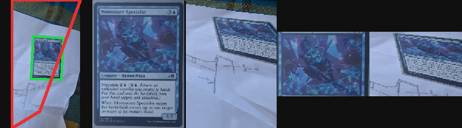
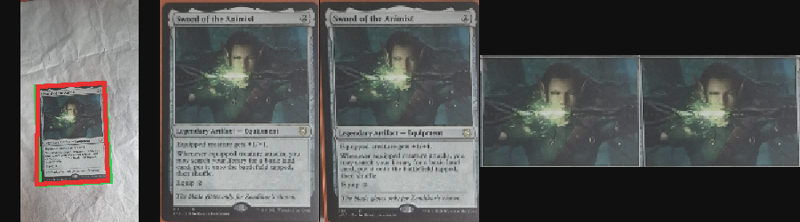

# Frozen recognition and geometry report

Nothing in this run was promoted or deployed. The 0.05 margin, the identity splits, the human quads, the CLIP encoder, the linear adapter, and the geometry ranker were not changed.

Authority: train is descriptive, dev is validation, holdout is the frozen test.

## 1. Executive summary

The one lost holdout safe hit that comes from geometry is Moonsnare Specialist `geom-009`. The current detector quad covers the table. A tight candidate was already in the candidate list (IoU 0.934). The frozen learned ranker selects that candidate, and the frozen agreement rule publishes Moonsnare again.

The other lost safe hit, Sword of the Animist, is a correct card with a prototype margin of 0.024. The detector quad matches the card (IoU 0.951). The learned ranker selects the same quad. That loss is recognition sensitivity.

Across all 26 holdout photos the learned ranker raises raw prototype Top1 from 14 to 16 and removes every selected quad below IoU 0.50. The agreement publish count stays 10 correct and 0 wrong, because Moonsnare and one Whiplash Trap are gained and Kaito `geom-003` plus Ulamog's Crusher are lost. Verdict: `LEARNED_GEOMETRY_NEUTRAL`.

No holdout frame lacks a candidate at IoU 0.70. Two Yuriko frames top out at 0.776 and 0.785. Those were not safe publishes. The safe-hit gap is candidate selection, not candidate generation.

## 2. Geometry diagnosis

### Moonsnare geom-009 — `CARD_QUAD_FAILURE`

Frame `geometry-test-20261006-150559 geom-009`.

| | Human quad | Current detector | Learned ranker |
|---|---|---|---|
| Card IoU | 1 | 0.196 | 0.934 |
| Mean / max corner error | 0 | 651 / 789 px | — |
| Area ratio | 1 | 4.312 | — |
| Area outside the physical card | 0 | 0.798 | — |
| Human card inside the quad | 1 | 0.872 | — |
| Art box | emitted, confidence 0.797 | not emitted | emitted on the tight quad |
| Clean / prototype Top1 | Moonsnare / Moonsnare | Road / Tranquil Cove | Moonsnare / Moonsnare |
| Prototype margin | 0.084 | 0.026 | 0.113 |
| Agreement publish | yes | no | yes |

The selected quad is the `luma@28` candidate, detector score 0.713, learned utility 0.419, IoU 0.196. The best candidate is `edge`, detector score 0.848, learned utility 0.876, IoU 0.934. A third candidate, `luma@18`, has the highest detector score (0.896) and IoU 0.148.

Counterfactuals, same art-crop code:

- A. Human quad + human art box: Moonsnare, margin 0.084, publish.
- B. Detector quad + fallback art window: Tranquil Cove, margin 0.026, no publish. Rank 2300.
- C. Detector art box on the human warp: not run. The detector warp emitted no art box.
- D. Human art box on the detector warp: Tranquil Cove, margin 0.033, no publish.

The upright detector image is the table. Placing the correct art window on that image still does not retrieve Moonsnare. The missing art box follows from that warp.

Strip, left to right: source with the human quad in green and the detector quad in red, human warp, detector warp, human crop, detector crop.



### Sword of the Animist — `RECOGNITION_SENSITIVITY`

Frame `geometry-test-20260910-165339 geom-006`. Human prototype margin 0.0724.

| | Human | Detector |
|---|---|---|
| Card IoU | 1 | 0.951 |
| Mean / max corner error | 0 | 17.6 / 25.9 px |
| Area ratio | 1 | 0.976 |
| Area outside the card | 0 | 0.013 |
| Art box | confidence 0.932 | confidence 0.723 |
| Art-box corner shift | — | 11.6 px |
| Art vertical span | 0.106–0.559 | 0.106–0.568 |
| Clean / prototype | Sword / Sword | Sword / Sword |
| Prototype margin | 0.072 | 0.024 |
| Agreement publish | yes | no |

The learned ranker selects the same quad, so the publish stays off.

- C. Detector art box on the human warp: Sword, margin 0.091, publish.
- D. Human art box on the detector warp: Sword, margin 0.120, publish.

The card and the art box are both structurally right. The production pairing sits under 0.05.



### Full holdout attribution

Changed means a Top1 oracle id differs, the agreement bit differs, or the prototype margin moves by at least 0.01. Card-quad failure uses the existing bands: IoU below 0.80, area ratio outside 0.75–1.25, or more than 20% of the quad outside the card. Art failure means a missing art box or a mean corner shift above 40 px on the 744×1039 card.

| Class | Frames |
|---|---|
| `UNCHANGED` | 5 |
| `RECOGNITION_SENSITIVITY` | 14 |
| `OUTER_QUAD_DOMINANT` | 4 |
| `MULTIPLE` | 2 |
| `ART_CROP_DOMINANT` | 1 |
| `NOT_MEASURABLE` | 0 |

The four outer-quad frames are Yuriko `geom-002` (IoU 0.367), Moonsnare `geom-009` (0.196), Kaito `geom-010` (0.318), and Crypt Lurker `geom-041` (0.745). Only Moonsnare was a human safe hit.

The two multiple frames are Yuriko `geom-001` (IoU 0.491, art shift 58 px) and Yuriko `geom-004` (IoU 0.605, art shift 83 px). Neither was a safe hit. `geom-001` is the prototype hit on Skaab Wrangler that agreement withholds.

The art-crop label is unsleeved Negate. The human warp did not emit an art box and used the canonical window. The detector warp did emit one. Both still publish Negate (margins 0.125 and 0.084). Card IoU is 0.853. This is not a safe-hit loss.

Card IoU against recognition change, using the existing 0.50 / 0.70 / 0.80 bands:

| Selected IoU | Frames | Prototype Top1 losses | Margin drops ≥ 0.02 | Safe-hit losses |
|---|---|---|---|---|
| < 0.50 | 4 | 3 | 4 | 1 (Moonsnare) |
| 0.50–0.70 | 1 | 0 | 0 | 0 |
| 0.70–0.80 | 1 | 0 | 0 | 0 |
| ≥ 0.80 | 20 | 2 | 6 | 1 (Sword) |

A bad quad lines up with identity changes. A good quad still loses margin often enough that IoU is not a publish threshold, and none was derived.

## 3. Learned-ranker counterfactual

Frozen challenger `gbm-iou-all-2dd2ec36b833`. Not retrained. Same accepted candidates as the current detector. Selection is the highest learned utility, with the training tie break.

Holdout geometry of the selected quad:

| | Current selector | Learned ranker |
|---|---|---|
| IoU ≥ 0.80 | 20/26 | 24/26 |
| IoU ≥ 0.70 | 21/26 | 26/26 |
| IoU < 0.50 | 4/26 | 0/26 |
| Median IoU | 0.926 | 0.945 |
| p10 IoU | 0.429 | 0.867 |

Holdout recognition under the frozen agreement rule:

| | Clean Top1 | Prototype Top1 | Correct published | Wrong published |
|---|---|---|---|---|
| Human quad | 16/26 | 19/26 | 11 | 0 |
| Current detector | 12/26 | 14/26 | 10 | 0 |
| Learned ranker | 13/26 | 16/26 | 10 | 0 |

Mean prototype rank of the correct card: human 535, current detector 1582, learned ranker 391.

`LEARNED_GEOMETRY_NEUTRAL`

The publish count does not move. The contents do:

| Frame | Current IoU → learned IoU | Detector publish | Learned publish |
|---|---|---|---|
| Moonsnare geom-009 | 0.196 → 0.934 | no (Tranquil Cove) | yes (Moonsnare, margin 0.113) |
| Whiplash Trap geom-033 | 0.873 → 0.928 | no | yes (Whiplash Trap, margin 0.081) |
| Kaito geom-003 | 0.908 → 0.972 | yes (Kaito, margin 0.167) | no (clean Havi, prototype Kaito, margin 0.025) |
| Ulamog's Crusher geom-032 | 0.989 → 0.971 | yes (Ulamog's Crusher) | no (Beast Within, margin 0.010) |

Thirteen holdout frames change candidate. The other IoU moves stay above 0.70. Ulamog's Crusher is the case where a slightly different good quad changes the prototype Top1 to the wrong card. The agreement rule withholds it.

## 4. Candidate-generation ceiling

For every holdout frame the best candidate IoU was computed again.

| Best candidate | Frames |
|---|---|
| ≥ 0.80 | 24 |
| 0.70–0.80 | 2 |
| < 0.70 | 0 |

Geometry-related recognition failures:

| Class | Count | Frames |
|---|---|---|
| `SELECTION_FAILURE` | 3 | Moonsnare geom-009, Kaito geom-010, Yuriko geom-004 |
| `BOTH_POSSIBLE` | 2 | Yuriko geom-001 (best 0.776), Yuriko geom-002 (best 0.785) |
| `GENERATION_FAILURE` | 0 | — |
| `NOT_A_GEOMETRY_MISS` | 3 | Sword of the Animist, Chasm Skulker geom-009, Sprouting Goblin |

Highest-value generation gaps, both still inside the usable band:

1. Yuriko `geom-002`. Best IoU 0.785. Current 0.367. Learned 0.724. Human prototype Top1 was correct and unpublished (margin 0.047). Detector and learned both name other cards.
2. Yuriko `geom-001`. Best IoU 0.776. Current 0.491. Learned takes that best candidate. Human prototype Top1 is the withheld Skaab Wrangler miss.

A good candidate exists for the Moonsnare safe-hit loss. Generation does not have to move before selection does.

## 5. Recognition system

Encoder `Xenova/clip-vit-base-patch32@q1`, 512 dimensions. Adapter `linear-identity-v1` (challenger). Galleries: clean, and the mean of adapted clean + blur 2.4 + motion 9 + perspective 0.09. Publish requires prototype margin ≥ 0.05 and the same oracle id on both galleries.

Raw rows are Top-k only. Publish columns are the three frozen policies.

### Holdout (n = 26) — final test

| Geometry | Clean Top1 | Proto Top1 | Clean+0.05 correct/wrong | Proto+0.05 | Agreement |
|---|---|---|---|---|---|
| Human | 16 | 19 | 8/0 | 12/2 | 11/0 |
| Current detector | 12 | 14 | 9/0 | 10/0 | 10/0 |
| Learned ranker | 13 | 16 | 10/0 | 10/0 | 10/0 |

Human Top3/5/10: clean 18/18/19, prototype 21/21/22. Median rank 1. Detector prototype Top3/5/10: 16/17/19. Learned prototype: 18/18/21.

### Dev (n = 17) — validation

| Geometry | Clean Top1 | Proto Top1 | Clean+0.05 | Proto+0.05 | Agreement |
|---|---|---|---|---|---|
| Human | 15 | 14 | 4/0 | 8/0 | 7/0 |
| Current detector | 9 | 12 | 7/0 | 8/1 | 8/0 |
| Learned ranker | 12 | 13 | 7/0 | 10/0 | 9/0 |

The dev agreement counts are higher for the detector and the ranker than for the human quad. That is recorded. It was not used to change a threshold or to promote.

### Train (n = 70) — descriptive only

| Geometry | Clean Top1 | Proto Top1 | Clean+0.05 | Proto+0.05 | Agreement |
|---|---|---|---|---|---|
| Human | 50 | 47 | 36/1 | 35/0 | 34/0 |
| Current detector | 41 | 45 | 27/4 | 30/1 | 29/1 |
| Learned ranker | 46 | 49 | 32/2 | 37/0 | 34/0 |

## 6. Safety

Holdout and dev agreement publishes, all three geometries: wrong published = 0.

Known unsafe cases the rule is there to catch:

- Holdout, human quad, prototype margin alone: The Spear of Leonidas → Predator, Flagship, margin 0.053. Clean Top1 is Case of the Burning Masks. Agreement withholds.
- Holdout, human quad, prototype margin alone: Yuriko `geom-001` → Skaab Wrangler, margin 0.051. Clean Top1 is Famished Foragers. Agreement withholds.
- Dev, detector crop, prototype margin alone: a Livaan foil → Kenrith, the Returned King, margin 0.075. Clean Top1 is Rosnakht, Heir of Rohgahh. Agreement withholds.
- Holdout, learned crop: Ulamog's Crusher `geom-032` → Beast Within, margin 0.010. Withheld by the margin.

The rule will publish a wrong card when both galleries agree and the margin is at least 0.05. That happens once in this run, on the train split only: unsleeved Island, both galleries return Double-Faced Substitute Card, prototype margin 0.058. Train is not an authority split. The reference test covers this case on purpose. The threshold was not moved.

Learned-ranker agreement publishes no wrong card on train, dev, or holdout in this run.

## 7. Performance and storage

| | Bytes | Loaded RAM |
|---|---|---|
| Clean gallery, float32 | 102,334,464 | 97.6 MiB |
| Prototype gallery, float32 | 102,334,464 | 97.6 MiB |
| Both embeddings | 204,668,928 | 195.2 MiB |
| Shared `refs.json` | 11,231,925 | 11.2 MiB once |

Count 49,968. Dimension 512. One clean search on this machine, dot products only, was about 24 ms. Two separate searches were about 44 ms (1.8×). One loop that dots the same query against both galleries was about 28 ms (1.15×). The arithmetic is still two galleries. The fused loop keeps the query in cache and reads each embedding once per gallery. This is a host timing of the loop, not a phone timing, and it does not include CLIP.

`loadGalleryIndex` reads the whole float32 file into memory. It does not memory-map. `scripts/recognition/index-formats.mjs` can write float16 and int8 bakeoff indexes. Those formats are not the frozen gallery, and this run did not score them.

A prototype shortlist followed by a clean search would change results. Spear of Leonidas is the example: the two galleries' Top1 cards differ. Restricting the clean search to a prototype shortlist would not be the frozen rule.

The production cost of agreement is two similarity searches. Packing the two vectors for each artwork into one pass is available as an implementation choice. It does not remove the second gallery from memory or from the arithmetic.

## 8. Reproducibility

```
node scripts/scanner-benchmark/identity/frozen-geometry.mjs
node scripts/scanner-benchmark/identity/frozen-score.mjs
node scripts/scanner-benchmark/identity/freeze-prototype.mjs
node scripts/scanner-benchmark/identity/agreement-test.mjs
```

| Artifact | SHA-256 |
|---|---|
| `scanner-benchmark/reports/frozen-recognition-v1/geometry.jsonl` | `387e3e3b1f1165751ca9fe6be07e56fb5b371c0a9dab4aff28be6c4c75748b52` |
| `scanner-benchmark/reports/frozen-recognition-v1/scored.json` | `c4644d3b756727992c5229f8229c18e13c94e66f7386e62b94a663acc1b32e71` |
| Prototype `embeddings.bin` | `7cfb59e52db439239ee4a1af6b22596a539d43eccfe1afb3d7835027d5a683d1` |
| Clean gallery | `11590af3c688658609b517b52cf4d20ab82d024a2f012ce7efe49dd7e13f67d3` |
| Blur view | `0be9498a732007840b7b1a01437767d005d2f7d708f38aaadfc38d1a907c3544` |
| Motion view | `083e1ed03f93f99f6e4049cb9a0409dddbb110aebd2ffb99f7b3ce4eaea551ba` |
| Perspective view | `b43f1fb8f5a84e8bfbadcfaf2c25de6c271f05fa0aca353be2cee3576825d2cd` |
| Adapter `linear-identity-v1.json` | `afed03d3fbd0b1d0f04dedba07366656941bdcac9bed868550300d031fff44c8` |
| Ranker `gbm-iou-all-2dd2ec36b833.json` | `4a9919ce5facf2692a785be3993853c9793d3a8de2916d964b756a8df3cb541b` |

Prototype manifest: `scanner-benchmark/identity-registry/candidates/mean-prototype-v1/manifest.json`. `promoted` is false. Replay of the mean on the same four adapted buffers drifted by 0. Reload from disk drifted by 0. Sampled vectors have unit norm within 1e-4. A reload nearest-neighbor check on the Moonsnare human crop matched the in-memory index (Moonsnare Specialist, oracle `ba858b68-ae93-4e1c-8a3a-3e4ac97282e8`).

Per-frame scores: `scanner-benchmark/reports/frozen-recognition-v1/frames.json`.

Tests that passed: `agreement-test.mjs`, `ranker/test.mjs`, `geometry/source-space-test.mjs`, `geometry/frame-regions-test.mjs`, `embedding/art-margin-test.mjs`, `embedding/auto-policy-test.mjs`, `embedding/crop-ceiling-test.mjs`, `scanner-benchmark/test.mjs`, `scripts/scan-test.mjs` (`all scan checks passed`). No production test failed, so nothing was patched.

## 9. Recommended production architecture

Not implemented.

Keep the current detector selector and the B1 recognition champion in the product until a person promotes a challenger.

The system this evidence supports, still offline:

1. The detector proposes the same candidates it proposes now.
2. The frozen `gbm-iou` ranker picks one candidate. This is the piece the next stage has to integrate, and the Ulamog `geom-032` swap has to be understood before a promotion.
3. Warp that quad, run the existing frame-region art box, and use the existing +3% pad. If no art box is emitted, keep the existing canonical window.
4. Embed once with frozen CLIP ViT-B/32 and the linear challenger.
5. Dot that vector against the clean gallery and the mean-prototype gallery, sharing `refs.json`, in one pass.
6. Publish only when the prototype margin is at least 0.05 and the two Top1 oracle ids match.

OCR stays out of this path. The prototype file stays a candidate.

## 10. One next action

`INTEGRATE_LEARNED_GEOMETRY_FIRST`

The holdout safe-hit that geometry can fix is a selection miss: Moonsnare's 0.934 candidate was generated and the current selector took the table. The frozen ranker takes the card, the publish returns, and holdout wrong publishes stay at zero. No holdout frame is missing a 0.70 candidate. The recognition rule is already safe on dev and holdout. Integrating that ranker is the next stage. This run does not start it, and it does not promote the ranker.
